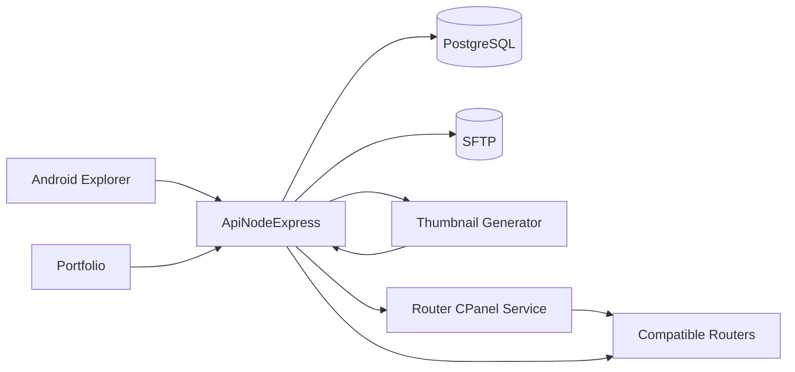
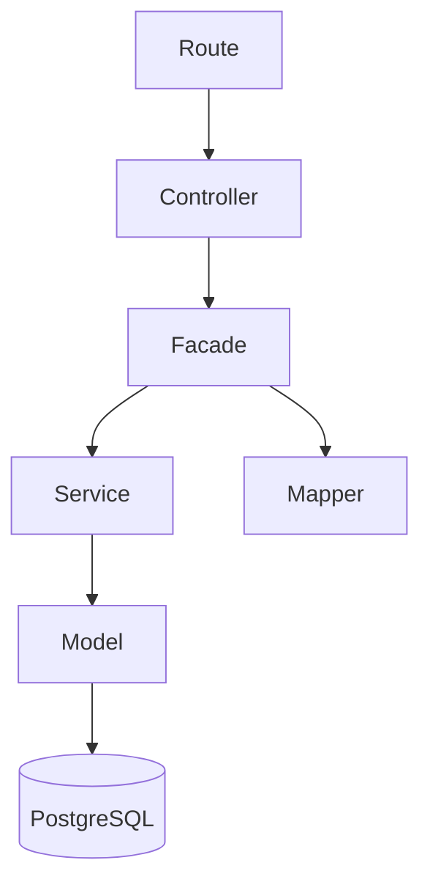

# ApiNodeExpress

[](https://nodejs.org/)

[](https://www.postgresql.org/)

[](https://pnpm.io/)
[](LICENSE)

> **A portfolio-grade REST API inspired by Spring architecture, built to manage home network resources through clean, maintainable software engineering principles.**



ApiNodeExpress is the backend foundation of a growing ecosystem designed around real-world network management rather than a simple CRUD application.


## Why this project?

ApiNodeExpress was created to solve real-world home lab problems while serving as a long-term portfolio project.

Its goal is to provide a maintainable backend capable of managing authentication, network resources, router automation and remote file access through a clean, layered architecture.

---

## Features

| Area | Description |
|------|-------------|
| Authentication | JWT authentication with refresh token rotation |
| Authorization | Role + Scope ACL |
| Routing | Route-level authentication that preserves `404` responses for unknown endpoints |
| Users | Delegated user administration |
| Devices | Multiple connections per device, router SSID and Wi-Fi credentials |
| Router Sync | MAC whitelist synchronization |
| Router Control Panel | Isolated Chromium/noVNC router sessions managed through the API |
| Storage | Transactional streaming SFTP transfers, progressive write operations and lazy thumbnails generated by an adaptive FFmpeg service |
| Resource Sync | Authenticated WebSocket subscriptions for database versions and SHA-256 FTP directory hashes |
| Validation | Centralized Zod schemas |
| Error Handling | Unified ApiError pipeline |
| Testing | Vitest + executable HTTP documentation |

## Why Spring-inspired?

The project borrows Spring concepts such as layered responsibilities, explicit separation of concerns and use-case orchestration while remaining lightweight and idiomatic to Node.js.

## Architecture



> Each layer owns a single responsibility, making business rules easy to locate, test and evolve.

| Layer | Responsibility |
|---|---|
| Controller | HTTP input/output |
| Facade | Use-case orchestration, ACL and transactions; uses Mapper to transform data |
| Mapper | Domain transformation |
| Service | Business rules |
| Model | SQL and persistence |

## Getting Started
Follow these steps to run the project locally

**Requirements**

- Node.js 24.x
- PostgreSQL 16+
- pnpm

### Installation

```bash
pnpm install
pnpm --dir thumbnail-generator install
pnpm --dir router-cpanel-service install
```

### Configuration

Copy `.env.example` to `.env` for the API, `thumbnail-generator/.env.example` to `thumbnail-generator/.env`, and `router-cpanel-service/.env.example` to `router-cpanel-service/.env`. Configure the required secrets and internal service URLs. The API communicates with the thumbnail generator through `THUMBNAIL_GENERATOR_URL` and with the router panel service through `ROUTER_CPANEL_SERVICE_URL`; the cPanel service exposes only its noVNC viewer publicly while its session API stays on the internal network.

Runtime limits, cache lifetimes, SFTP pool sizes, WebSocket sessions and JWT expirations are configured exclusively through the environment variables documented in the corresponding `.env.example`; they have no application defaults. Numeric values are expressed as bytes, counts or milliseconds as indicated by their names. Protected FTP and WebSocket reservations use `user-id:ftp=connections|socket=connections` entries separated by commas through `PROTECTED_USERS`; a user may reserve either service, and use an empty value when no user needs a reservation. `thumbnail-generator` configures its adaptive FFmpeg queue independently through initial concurrency, CPU and memory targets, scheduler interval, output size, pixel and timeout limits. `router-cpanel-service` configures its public URL, isolated JWT secret, Chromium/VNC display ranges, owner/session limits, VNC viewers per session and inactivity timeout independently. Missing or inconsistent configuration prevents the corresponding service from starting.

### Running

```bash
pnpm run postgres
pnpm --dir thumbnail-generator start
pnpm --dir router-cpanel-service start
```

### Testing

```bash
pnpm test
pnpm --dir thumbnail-generator test
pnpm --dir router-cpanel-service test
```

Manual API documentation is available under `tests/http`.

## Core Modules

- **Auth** — JWT authentication and refresh tokens.
- **Users** — User administration and Role + Scope ACL.
- **Devices** — Network inventory and connection management.
- **Whitelist** — Router synchronization.
- **FTP/SFTP** — Streaming file management, per-file transfers and lazy thumbnails.
- **Socket Sessions** — Authenticated WebSocket sessions and authorized resource-change subscriptions.
- **Thumbnail Generator** — Isolated FFmpeg processing with an adaptive global queue over temporary range-enabled media streams.
- **Router CPanel Service** — Isolated Chromium/Xvfb/x11vnc sessions for router administration, with ownership, viewer and inactivity control.
- **Resource Synchronization** — Database versions and per-directory FTP hashes published through authorized WebSocket subscriptions.

## API Usage

The .http files act as executable documentation and manual integration tests:

```text
tests/http/
```

These files serve as:

- Documentation
- Manual integration tests
- Usage examples

Collection endpoints keep their original response bodies and expose synchronization metadata through headers:

- `Data-Version` for users, devices and FTP directory listings.
- `Devices-Version` and `Whitelist-Version` for allowed and not allowed device listings.

FTP directory listings and applicable write responses expose a SHA-256 directory hash through `Data-Version`. Upload completion, directory creation and renaming return a refreshed listing. Move and delete operations send progress through streamed events; the final `move` event includes the source and destination directories with their corresponding hashes.

Authentication is attached to each protected endpoint instead of being applied globally. Requests to existing protected routes without a valid bearer token return `AUTHENTICATION_REQUIRED`, while unknown paths reach the standard `ROUTE_NOT_FOUND` response.

Clients create an authenticated socket session, then connect to `/events/:sessionId` and subscribe with their access token and the authorized entities they need:

```http
POST /socket-sessions
Authorization: Bearer <access token>
```

```json
{
    "id": "<session id>",
    "expiresAt": "<ISO-8601 timestamp>"
}
```

```json
{ "accessToken": "<access token>", "entities": ["devices", "whitelist"] }
```

The server publishes changes only for the subscribed entities. Database changes include their version; FTP changes also include the affected directory and its SHA-256 hash. Sessions can be refreshed with `POST /socket-sessions/:id/refresh` or closed with `DELETE /socket-sessions/:id`.

The final event for a move includes both refreshed directory states:

```json
{
    "event": "complete",
    "source": { "dir": "source", "version": "<SHA-256 directory hash>" },
    "destination": { "dir": "destination", "version": "<SHA-256 directory hash>" }
}
```

Uploads are parsed as multipart streams and files may be sent individually through ordered, offset-based requests without writing intermediate data to local storage. A failed or abandoned upload is cleaned as one transaction. Download sessions return a recursive manifest; clients download each file individually and may provide an offset to resume. A failed download invalidates the session.

Router control panel sessions are created through `POST /devices/:id/cpanel` with a validated `clientType`, optional `language` and theme. The API obtains router credentials internally and returns a public noVNC viewer URL with the session identifier and expiry. `POST /devices/cpanel/:sessionId/navigation` accepts `back` or `reload`, and `DELETE /devices/cpanel/:sessionId` closes the session. The API is the only consumer of the cPanel service session API; the browser viewer uses the service's dedicated, revocable JWT and never receives router credentials.

Delete and move operations stream progress events as entries complete. The API invalidates affected directory state on failure, while the client only applies a completed operation as a whole.

Transfer, move and delete operations protect their selected entries and the directory paths needed by the operation. Conflicting operations wait, while independent work in the same directory can continue. Upload, move and delete retain their path locks through the final directory refresh; download locks are released after all file streams finish. Locks are managed per user and do not prevent changes made outside the API.

SFTP clients are reused through isolated per-user pools for internal work, reads and writes. Pools, caches and protected reservations use the stable user UUID, so changing a username does not change its storage identity. The UUID remains canonical inside the API and is converted to a 32-character, hyphenless Ubuntu username only when opening the SFTP connection. Each active user starts with one reserved connection per pool; reads can scale to two connections and writes to three, subject to the global connection and transfer limits. Idle sessions close after the configured timeout, active work is never interrupted, and protected users retain their base reservation.

Directory listings mark compatible media with `supportsThumbnail`. Thumbnail generation runs lazily in the background and adds each result to the bounded cache as soon as it is available. The thumbnail endpoint reports generated, pending and unavailable states with HTTP `200`, `404` and `204` respectively.

Media processing is delegated to the standalone thumbnail generator. The API submits thumbnail work while the generator owns a global adaptive FFmpeg queue: it starts from the configured initial concurrency and adjusts admission from its container CPU and memory usage. The API exposes short-lived, range-enabled media sessions so FFmpeg can seek through SFTP files without sharing FTP credentials or buffering complete media files. Internal media access restricts its accepted origin and is intended to remain unavailable through the external reverse proxy; generated JPEG responses are limited by environment configuration.

## Key Architectural Decisions

- Split `Connection` from `Device` to support multiple interfaces.
- Introduced a dedicated `Facade` layer for use-case orchestration.
- Migrated from FTP to SFTP.
- Implemented a Role + Scope ACL model.
- Centralized validation and error handling.
- Applied authentication and role checks directly to protected routes so unknown resources remain distinguishable from unauthenticated requests.
- Added authenticated WebSocket sessions and authorized resource-change subscriptions for lightweight client synchronization.
- Streamed multipart uploads and per-file downloads without buffering complete files.
- Added resumable offset-based uploads, all-or-nothing transfer cleanup and streamed move/delete progress.
- Coordinated per-user entry and path locks across transfers and progressive write operations.
- Reused SFTP sessions through bounded per-user internal, read and write pools identified by stable UUIDs, with idle eviction and protected reservations.
- Added bounded in-memory thumbnail caching with lazy background generation.
- Isolated FFmpeg in a dedicated thumbnail service with fixed protocols, demuxers, resource limits, adaptive queued scheduling and temporary range-enabled access to SFTP media.
- Isolated router administration in a dedicated Chromium/Xvfb/x11vnc service with one active session per owner, revocable viewer access and controlled VNC capacity.

## Project Structure

```text
src/
    config/
        constants.js
        environment.js
        errors.js
        secrets.js
    controllers/
    devices-routers/
    facades/
    mappers/
    middlewares/
    models/
    routes/
    schemas/
    services/
    utils/
        cache/
        connection/
        error/
        gateways/
        token-providers/
    app.js
    server-postgres.js
tests/
thumbnail-generator/
    .env.example
    src/
        config/
        controllers/
        routes/
        services/
        app.js
        server.js
    tests/
router-cpanel-service/
    .env.example
    public/
    src/
        config/
        controllers/
        middlewares/
        routes/
        services/
        utils/
            error/
            gateways/
            token-providers/
        app.js
        server.js
    tests/
```

## Design Principles

- Single Responsibility.
- Readability.
- Maintainability.
- Centralized validation.
- Explicit business rules.
- Simplicity over premature optimization.

## Status

🚧 **Actively developed**

This project is actively used as the backend foundation for future applications and portfolio projects.

## Roadmap

- [x] Authentication
- [x] Role & Scope ACL
- [x] Device Management
- [x] Router Synchronization
- [x] SFTP Integration
- [x] Android Explorer
- [ ] Portfolio
- [ ] TypeScript Migration

---

*ApiNodeExpress is intended to remain a long-term project where new modules and consumers can be added without compromising the existing architecture.*


## License

This project is licensed under the MIT License. See the `LICENSE` file for details.
